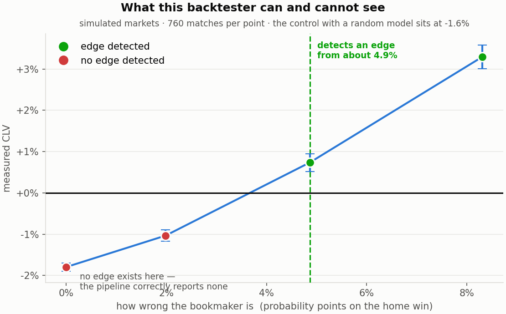
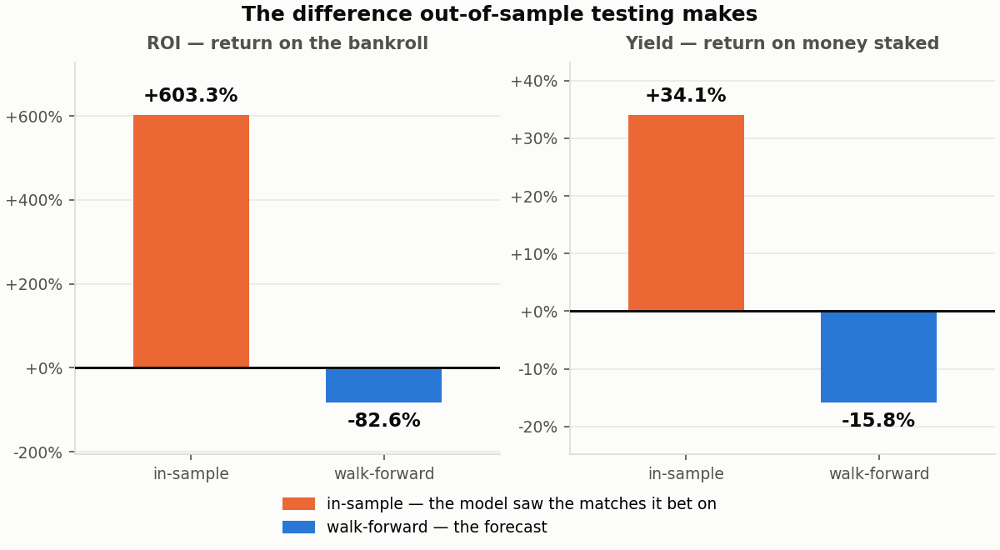
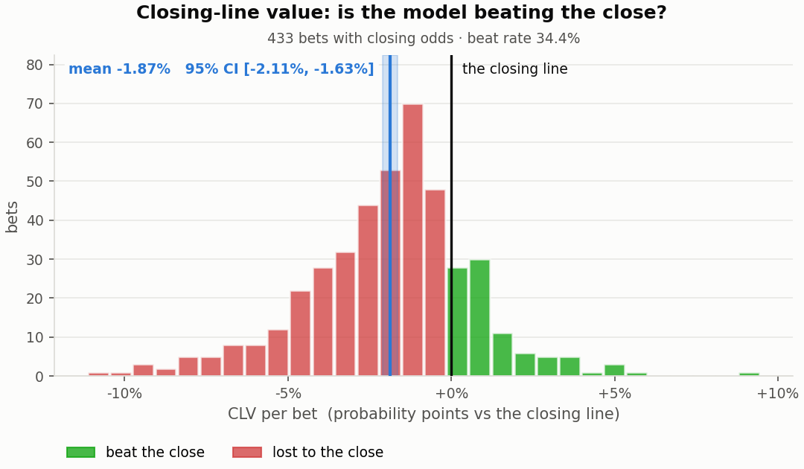
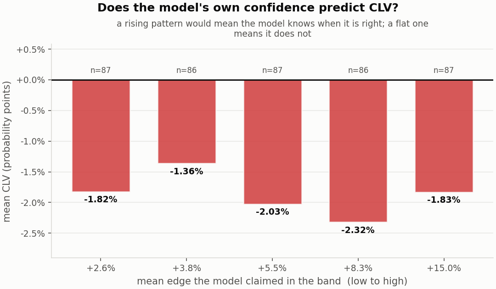
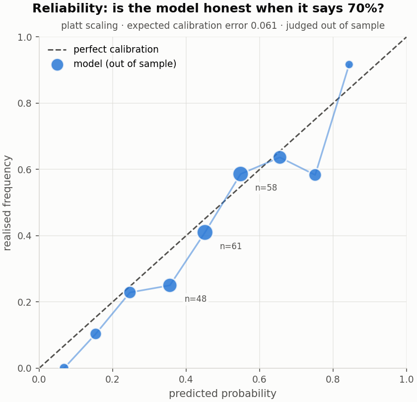
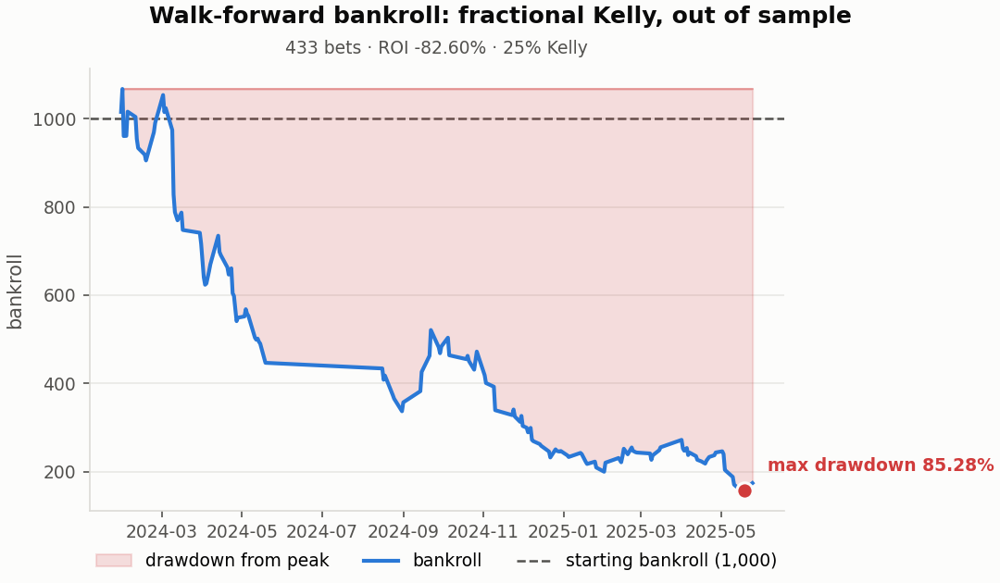
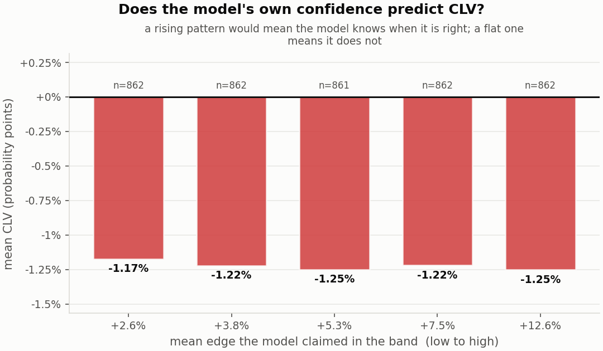
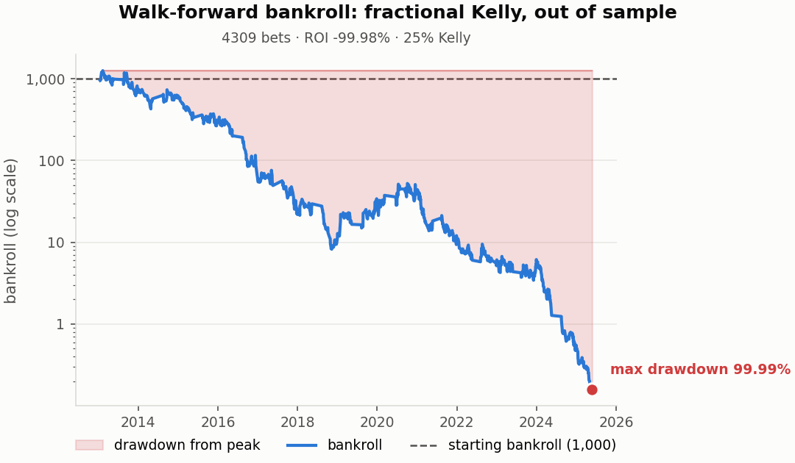

# V8 Quantitative Football Model

A football match-prediction and staking system that I built to the standard a bank's model-validation team would apply: Dixon-Coles goal modelling, out-of-sample probability calibration, fractional-Kelly staking, walk-forward backtesting with lookahead guards, and closing-line value as the test of whether there is any edge.


---

## The short version

The model does not beat the market, and I can show it three ways: the
walk-forward backtest loses money, the market never moves toward the model's
bets, and on the same matches the market's probabilities are more accurate
than the model's. Before trusting that answer I checked that the testing
machinery can find an edge when one exists. It can, once the bookmaker is
wrong by about 5 probability points.

## Can the backtester find an edge at all?

A backtest that reports "+4% CLV" means nothing unless it would have reported
nothing when there was nothing to find. So before looking at real data I
tested the machinery itself. `scripts/simulation_study.py` builds simulated
markets where I know the truth, because I wrote the process that generates
them, and runs the full pipeline on each one:



| Market | Truth | Measured CLV | = margin + market movement | Verdict |
|---|---|---|---|---|
| Efficient book | no edge exists | −1.79% [−1.90%, −1.70%] | −1.92% + +0.13% | correctly reports none |
| Underpriced by 2.0% | small edge | −1.03% [−1.17%, −0.90%] | −1.93% + +0.90% | below detection |
| Underpriced by 4.9% | real edge | +0.74% [+0.51%, +0.95%] | −1.93% + +2.67% | finds it |
| Underpriced by 8.3% | large edge | +3.29% [+3.01%, +3.58%] | −1.91% + +5.20% | finds it |
| Control: random model, efficient book | no edge, no information | −1.60% [−1.65%, −1.55%] | −1.67% + +0.06% | invents nothing |

Measured CLV rises with the mispricing I planted, and on an efficient book, or
for a model betting random probabilities, the pipeline reports no edge. On 760
matches it can establish an edge once the bookmaker is wrong by about 5
probability points, and not below that. That threshold is what makes the
real-data result interpretable: a measured movement near zero means "no edge
of detectable size", not "no edge".

### Calibrating the simulator against the real market

The control did not always pass for the right reason. When I split CLV into
margin and movement, the random-probability model was getting significant
market movement toward its bets, and it only passed because the bookmaker's
margin hid it. Both causes were in the simulator:

* It spread its margin proportionally, while the pipeline removes margin with
  Shin's method, which assumes the margin sits on longshots. Reading one
  convention with the other made long prices appear to shorten by themselves.
  The simulator now loads margin with the exact inverse of the pipeline's Shin
  calculation.
* Its closing price corrected all of the opening price's error, so any rule
  that backed long prices earned movement for free. Real books share most of
  their information between the open and the close.

I measured how much of the opening error the close corrects instead of
choosing it. `python scripts/simulation_study.py --calibrate` measures the
market movement on the longest 25% of opening prices, with no model involved,
on every real season file, and finds the simulator setting that reproduces it.
On EPL 2012-25 the real market gives +0.12% [+0.06%, +0.17%], and the
simulator gives +0.13% when the close corrects 40% of the opening error. The
detection threshold stays at 4.9 points for every setting between 20% and 50%,
which is the range the real data allows.

> The simulated markets make no claim about real betting markets. The edge in
> each biased market exists because I put it there. `python
> scripts/simulation_study.py` reproduces the table without any download, and
> `tests/test_simulation.py` checks that the generator produces coherent books,
> that its closing line corrects toward the truth, and the calibration above.

## The result on real matches

English Premier League, 2023/24 and 2024/25: 760 matches, 433 walk-forward bets.
Every figure in this section comes from `python scripts/make_charts.py`, which
writes `docs/charts/numbers.json`, and `tests/test_docs.py` fails if this README
quotes anything else. Run fingerprint `eddedac58a664dd8`.

| | In-sample | Walk-forward |
|---|---|---|
| ROI (on bankroll) | +603.26% | −82.60% |
| Yield (profit ÷ turnover) | +34.07% | −15.84% [−28.57%, −3.47%] |
| Bets | 260 | 433 |

Same model, same settings, same data. The only difference is whether the
model was allowed to see the matches it bet on. Fitted on everything, it
multiplies its bankroll; tested walk-forward, it loses most of it. That gap is
the clearest lesson in this project about what testing on seen data is worth.



The walk-forward yield interval excludes zero, so the loss is not just bad
luck. An earlier version of this README said the interval included zero. It
did, but it was the interval of a different number; see "two yields" in the
bug table below.

### What CLV says, and where it comes from



| Measure | Result |
|---|---|
| CLV, probability points (the measure I treat as authoritative) | −1.87% [−2.11%, −1.63%] |
| CLV, odds ratio | −2.44% [−3.11%, −1.74%] |
| Beat the close | 34.41% |

All three measures agree that the model does not beat the closing line. The
useful question is why. CLV in probability points compares the closing
market's fair probability with the price I took, and that price includes the
bookmaker's margin, so it splits exactly into two parts:

| CLV = | margin paid | + | market movement after the bet |
|---|---|---|---|
| −1.87% | −1.89% | + | +0.02% [−0.22%, +0.27%] |

Every bit of the negative CLV is the margin. Between the bet and kick-off the
market moved neither toward nor away from the model's picks, which is what a
model with no information looks like: it pays the margin on every bet and
never wins it back. The beat rate below 50% has the same cause. I bet into
Bet365's prices, which carry roughly twice Pinnacle's margin, so they are
shorter than Pinnacle's close even when the two books agree on the
probability.

The model's own claimed edge tells the same story. If the model had real
information, the bets where it claimed the most edge would show the most CLV:



The profile is flat. Bets the model rated at +15% edge did no better than bets
it rated at +2.6%, so it cannot tell where it is right. Given the simulation's
threshold of about 5 points, a movement of +0.02% means no edge large enough to
detect on two seasons; a smaller one would need more data to rule out.

### Are the model's probabilities better than the market's?

CLV asks whether the model finds prices the market later corrects. A simpler
question is whose probabilities are better on the same matches. The
walk-forward keeps the model's out-of-sample probabilities for every match it
priced, not only the ones it bet on, and `src/benchmark.py` scores them
against both markets (de-vigged with the same Shin method), match by match.
Both scores are losses, so a positive difference means the market did better.

| model minus market, paired over matches | 2 seasons, 552 matches | 13 seasons, 4,722 matches |
|---|---|---|
| log-loss vs opening (Bet365) | +0.0246 [+0.0060, +0.0434] | +0.0248 [+0.0188, +0.0308] |
| Brier vs opening | +0.0179 [+0.0060, +0.0298] | +0.0169 [+0.0129, +0.0209] |
| log-loss vs closing (Pinnacle) | +0.0311 [+0.0120, +0.0502] | +0.0284 [+0.0220, +0.0347] |
| Brier vs closing | +0.0230 [+0.0111, +0.0356] | +0.0192 [+0.0149, +0.0234] |

The market's probabilities are better than the model's on both scoring rules
and against both books, with every interval clear of zero. The opening line is
the fairer comparison, because it reflects about the same information the model
had, and the model still loses. This is the CLV finding from the other side:
where the model disagrees with the market, the market is usually right.

The test is paired: each match keeps its two scores together when the
bootstrap resamples. An upset is costly for every forecaster, so most of the
variation in log-loss is between matches rather than between forecasters, and
pairing removes it. `test_pairing_is_what_makes_the_comparison_precise` shows
the paired interval is less than half as wide.

On 13 seasons the model's home-win calibration error (0.0237) is also above
the 0.0213 that a perfectly calibrated forecaster would reach by chance on
those matches, so the model is detectably miscalibrated there. Both markets
sit under their floors.

### Calibration and bankroll




On two seasons calibration did not help out of sample. Platt scaling raised
the expected calibration error on the later half (it ends at 6.13%), and
isotonic regression made the model worse still, so I report that rather than
tuning until it passes. The diagram needs its noise floor to be read: on
341 matches a perfectly calibrated model would score up to 8.02% by chance alone
(the 95th percentile), so this diagram cannot show miscalibration in either
direction. The flat stretch in the bankroll curve is the 2024 close season,
when no bets were placed.

### Thirteen seasons: the same answer, measured more tightly

The headline uses two seasons. The long run uses every EPL season whose data
carries Pinnacle's closing odds, 2012/13 to 2024/25: 4,940 matches and
4,309 walk-forward bets. Its config, `configs/epl_2012_2025.yaml`, extends the
headline's and changes only the seasons, and a test enforces that, so any
difference comes from the extra history. Figures are from
`docs/charts/epl_2012_2025/numbers.json`, fingerprint `9ed0f574b163c749`.

| | 2 seasons (headline) | 13 seasons |
|---|---|---|
| CLV, probability points | −1.87% [−2.11%, −1.63%] | −1.22% [−1.29%, −1.15%] |
| of which margin paid | −1.89% | −1.24% |
| of which market movement | +0.02% [−0.22%, +0.27%] | +0.02% [−0.05%, +0.09%] |
| Yield | −15.84% [−28.57%, −3.47%] | −6.05% [−15.20%, +3.44%] |
| ROI | −82.60% | −99.98% |

No detectable movement over 13 seasons either. The market's movement after
the model's bets is still centred on zero, and the interval is much narrower,
so any information the model has that the closing line lacks is limited to a
few hundredths of a probability point. The margin is smaller than in the
headline because Bet365 charged less in the mid-2010s; its margin roughly
doubled from 2020/21, which `verify_raw_data.py` shows file by file.



Across 4,309 bets in five equal bands, the model's claimed edge says nothing
about its CLV: the bets it rated highest did no better than the ones it rated
lowest.



The yield interval includes zero, yet the bankroll is gone, and both are true.
Yield measures the average bet, while ROI compounds every loss into the stake
of the next. Quarter-Kelly sizing on a model with no edge loses a steady
fraction of whatever is left, and over thousands of bets that compounds to
almost nothing. On a log axis the curve is a steady slide rather than a crash.

---

## Why I built it

Bookmaker odds are an efficient estimate of match probabilities, and beating
them is hard. Most "profitable" betting models are overfit backtests that use
information that was not available when the bet was placed. I wanted to do the
opposite: model match outcomes carefully, size bets sensibly, and test any
claimed edge the way a model-validation team would, out of time, with
confidence intervals, against a benchmark that cannot be gamed.

[`docs/STUDY_GUIDE.md`](docs/STUDY_GUIDE.md) walks through every stage with the
real code, the maths, the trade-offs, the bugs, and the questions I expect to
be asked about it.

## What the data looks like

Before modelling anything, `notebooks/01_exploration.ipynb` measures what the
model assumes: home advantage, whether low scores are Poisson, the market's
margin and calibration, and whether shots carry signal. The findings, with
intervals, are in [methodology §1.5](docs/methodology.md). The most useful one
was about method. Against a league-average Poisson, 13 seasons show 1-1 eleven
per cent rarer than independence would predict, which argues against
Dixon-Coles. Against each match's own expected goals the effect disappears. It
came from mixing strong and weak teams, not from anything about football.

## The method

```
ingest -> features -> Dixon-Coles -> calibration -> staking -> walk-forward -> CLV
```

1. **Ingest and validate.** Results and odds are checked against a strict
   schema, and every validation rule lives in `config.yaml`, not in code.
2. **Features.** Attack and defence strengths with Bayesian shrinkage
   (`w = n/(n+k)`), exponential time decay (180-day half-life), and an
   expected-goals proxy from shots on target.
3. **Dixon-Coles.** Bivariate Poisson with the τ low-score correction, fitted
   by penalised, time-weighted maximum likelihood from several starting points.
4. **Calibration.** Platt and isotonic, both fitted on earlier data and judged
   on later data, scored with Brier, log-loss and expected calibration error.
5. **Staking.** Value is measured against the raw price (not the de-vigged
   one) and sized with fractional Kelly at 25%, capped per bet and per day.
6. **Walk-forward.** The model is refitted every 14 days with a strict same-day
   boundary, and a lookahead guard runs on every window of every run and
   raises an error if it finds a leak.
7. **CLV.** Closing-line value in three forms, each with a bootstrap interval,
   with the authoritative one chosen in advance.

The derivations are in [`docs/methodology.md`](docs/methodology.md).

## What this project shows and what it doesn't

It shows that the pipeline is free of leakage, that the numbers are
reproducible, and that the out-of-sample result is a loss. Reporting that,
rather than tuning until the backtest looks good, was the point.

It does not show a profitable betting strategy, and it does not test other
leagues, team news or in-play markets. Two seasons can rule out an edge of
about 5 probability points but not a smaller one, which is why CLV and its
decomposition are the headline rather than profit.

## Bugs I found, and what each one taught me

None of these showed up as an error. Each one is now pinned by a regression
test whose docstring tells the story.

| Bug | Symptom | Fix |
|---|---|---|
| Lookahead in the xG proxy | The conversion rate was fitted over the whole file, so August matches were priced using May's rate | `blend_goals` takes `history` as a required argument, so the caller must say which past it means |
| `+inf` objective | `inf − inf = nan` in the finite-difference gradient; L-BFGS-B stopped improving while still reporting `success: True` | A finite `INVALID_PENALTY` scaled by the size of the violation |
| ρ pinned at its bound | A bias that did not shrink with sample size (−0.012 at 240 matches, −0.018 at 2,400) | Bounds sized from observed goals, plus a `rho_at_bound` diagnostic |
| Value tested against the wrong price | Expected value was computed against the de-vigged probability, but the payout is at the actual odds | `edge` against the raw price decides bets; `disagreement` against the fair price is diagnostic only |
| CLV verdict inverted | The report said the interval "includes zero" when both measures excluded it, in opposite directions | Probability points made authoritative, with disagreement flagged explicitly |
| A regex that read prose as code | The dependency check failed on a package called `average`, picked out of a comment | Imports found with `ast` instead of a regex |
| Two yields under one name | On the same 433 bets the backtest printed −15.84% and the headline printed −10.08%, with an interval that included zero. One was profit ÷ turnover, the other the unweighted mean return per bet | Yield is profit ÷ turnover everywhere, with a bootstrap that resamples whole bets; the mean return is reported under its own name |
| Negative CLV blamed on the market | The report said the market "moves AWAY from" the model's prices. Decomposed, the movement was +0.02% and the whole figure was the bookmaker's margin | `decompose_clv` splits CLV into margin paid and market movement, and the verdict is chosen from the movement |

## Reproducing it

```bash
git clone https://github.com/esiihle/v8-quant-football-model.git
cd v8-quant-football-model
python -m venv .venv && source .venv/bin/activate
pip install -r requirements.txt

pytest                                   # the full suite
python scripts/run_pipeline.py --sample  # runs on the bundled 12-match sample
python scripts/simulation_study.py       # the study above; no data needed
```

The simulation study needs no downloads: it generates its own markets and
takes a few minutes, so anyone can reproduce it straight away.

For the real numbers the pipeline needs football-data.co.uk's season files in
`data/raw/`. That site is blocked on some networks, including mine, so the
repository can rebuild the files from two GitHub mirrors of it. One mirror
carries every bookmaker's odds, including Pinnacle's close, and the other
carries the shots. Run these from the folder that contains the repository:

```bash
git clone --depth 1 https://github.com/AnishKhetani/premier-league-data mirror-odds
git clone --depth 1 https://github.com/datasets/football-datasets       mirror-shots
cd v8-quant-football-model
python scripts/rebuild_raw_from_mirrors.py --odds ../mirror-odds --shots ../mirror-shots
python scripts/verify_raw_data.py data/raw/*.csv
```

The rebuild writes nothing if the mirrors disagree on a single score or if any
match or price is missing from either. The verifier then rejects a file whose
closing odds are missing or are a copy of the opening price. The second case
matters because the pipeline would run without complaint and report a CLV of
zero as if it had measured something. Any two or more seasons work, and
`config.yaml` names which.

Then:

```bash
python scripts/run_pipeline.py           # the full pipeline
python scripts/make_charts.py            # regenerates every chart above
python scripts/explore.py                # the exploration's numbers
python scripts/run_notebook.py           # re-runs the notebook and saves its outputs
pytest tests/test_docs.py                # checks this README against that run
```

The 13-season run uses a variant config that changes only the seasons (rebuild
them first with `--seasons 1213 1314 ... 2425`):

```bash
python scripts/make_charts.py --config configs/epl_2012_2025.yaml \
    --out docs/charts/epl_2012_2025 --only bankroll --only clv_by_edge
```

Every run prints a fingerprint, a hash of the settings that affect results:

```
run fingerprint: eddedac58a664dd8   (same fingerprint => same numbers)
```

If two runs with the same fingerprint, on the same machine and pinned
environment, give different numbers, the code is non-deterministic and that is
a bug. If the fingerprints differ, the settings differed. Across operating
systems the numbers agree to the reported precision but not always to the last
cent: the optimiser's floating-point arithmetic depends on the CPU's maths
library, and my Windows runs and Linux runs of the same fingerprint have
differed in turnover by less than one currency unit. `docs/charts/numbers.json`
records the figures and the fingerprint of the run that produced them, and
`tests/test_docs.py` checks the tables above against it.

## Why a football model, for credit risk

Every component has a direct counterpart in quantitative and credit-risk work:

| This repo | The real-world skill |
|---|---|
| Dixon-Coles MLE | Parametric modelling of count data |
| Bayesian shrinkage | Regularisation for thin samples and thin-file borrowers |
| Probability calibration | PD calibration in credit risk |
| Fractional Kelly | Position sizing under uncertainty |
| Closing-line value | Performance against a benchmark that cannot be gamed |
| Walk-forward with lookahead guards | Out-of-time model validation |
| Bootstrap intervals on every metric | Knowing when a result is not established |

## Repository structure

```
src/            ingest, features, dixon_coles, calibrate, staking, backtest, clv, metrics, exploration, benchmark
tests/          269 tests; the fragile numerics and every bug above
scripts/        run_pipeline.py, make_charts.py, simulation_study.py, verify_raw_data.py,
                rebuild_raw_from_mirrors.py, explore.py, run_notebook.py
configs/        epl_2012_2025.yaml (the 13-season run; extends config.yaml)
docs/           methodology.md, STUDY_GUIDE.md, OVERVIEW.md, ROADMAP.md, charts/
notebooks/      exploration
.github/        CI: pytest and a full pipeline run, on Python 3.11 and 3.12
```

## Author

Sihle Myeza, BSc Computer Science (Wits). I'm a data analyst working towards
quantitative and credit-risk roles, and I built this in the open, one commit at
a time.

## License

MIT; see [`LICENSE`](LICENSE).
