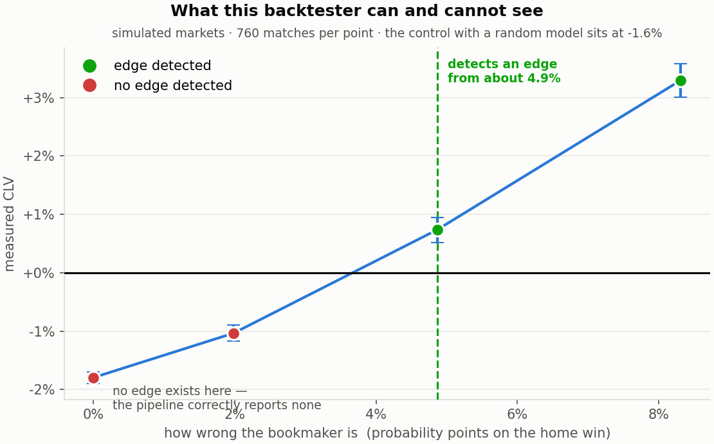
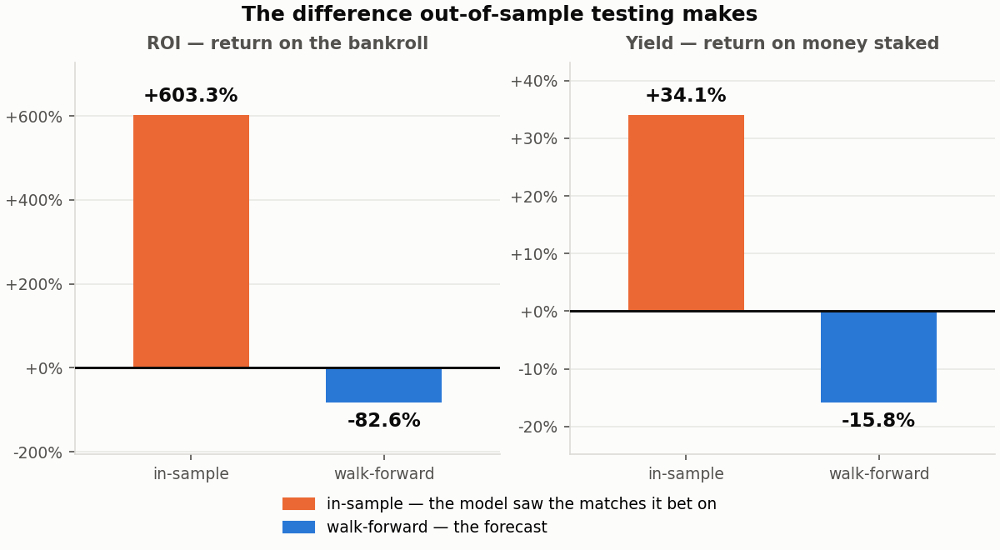
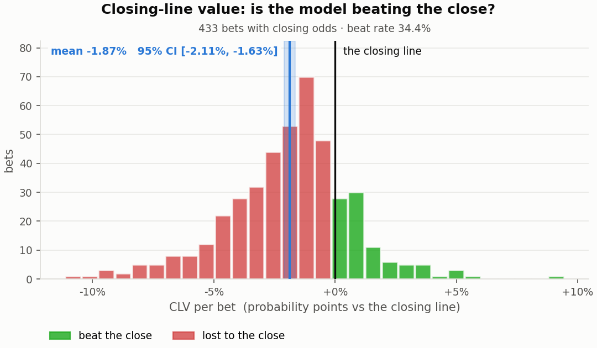
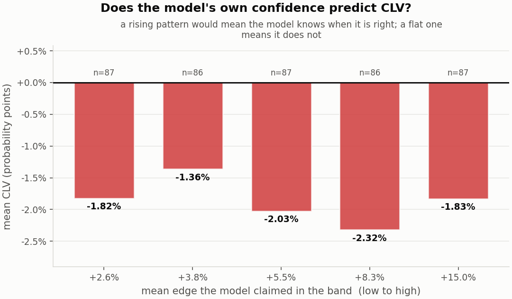
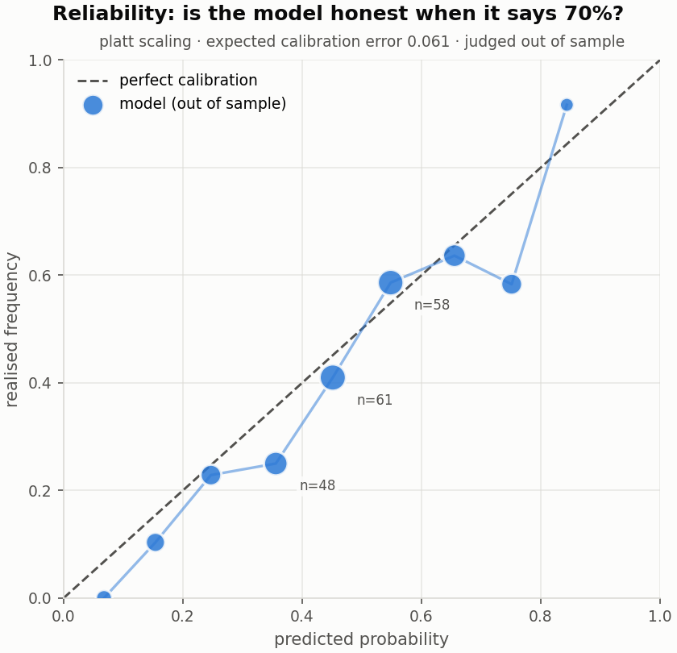
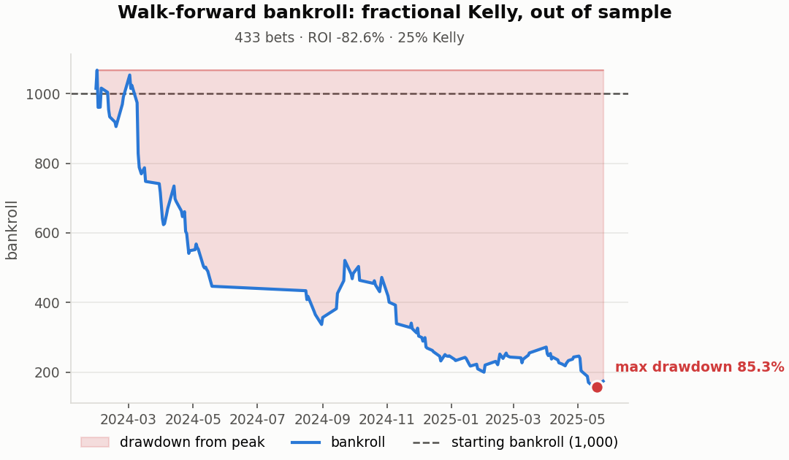

# ⚽ V8 — Quantitative Football Model

**A football match-prediction and staking system built to quant-validation standards: Dixon-Coles goal modelling, out-of-sample probability calibration, fractional-Kelly staking, walk-forward backtesting with lookahead guards, and closing-line value as the honest test of edge.**


---

## Does this backtester work?

Before asking whether a betting model is profitable, there is a prior question
that almost no backtest answers: **can the machinery tell signal from noise?**
A pipeline reporting "+4% CLV" is worthless unless you know it would have
reported nothing had there been nothing there.

`scripts/simulation_study.py` settles it. Three simulated markets whose
properties are known *by construction*, because the data-generating process is
written in the file:



| Market | Truth | Measured CLV | Verdict |
|---|---|---|---|
| Efficient book | no edge exists | −1.59% [−1.77%, −1.38%] | correctly reports none |
| Underpriced by 2.0% | small edge | −0.92% [−1.13%, −0.71%] | below detection |
| Underpriced by 4.9% | real edge | **+0.74% [+0.48%, +0.97%]** | **finds it** |
| Underpriced by 8.3% | large edge | **+3.34% [+3.03%, +3.64%]** | **finds it** |
| *Control:* random model, efficient book | no edge, no information | −1.20% [−1.31%, −1.09%] | invents nothing |

Two things are established here, and the second matters more than the first:

1. **The instrument responds.** Measured CLV rises monotonically with the
   mispricing planted in the book, and crosses zero where it should.
2. **The instrument does not hallucinate.** On an efficient book, and on a model
   betting random probabilities, it reports no edge. A backtester that invents
   edges is worse than useless, and that is the failure this control rules out.

**The detection threshold is the number to quote: on 760 matches this pipeline
can establish an edge once the bookmaker is wrong by about 5 probability points,
and not below that.** It is a statement about statistical power, and it is what
makes the real-data result below interpretable — a measured movement near zero
means "no edge of detectable size", not "no edge".

> **This is simulated data and makes no claim about real betting markets.** The
> edge in each biased market exists because it was deliberately put there.
> Reproduce it with `python scripts/simulation_study.py` — no download required,
> and `tests/test_simulation.py` checks the generator produces coherent books
> and a closing line that genuinely corrects toward the truth.

## The result on real matches

English Premier League, 2023/24 and 2024/25: 760 matches, 433 walk-forward bets.
Every figure in this section is generated by `python scripts/make_charts.py`
into `docs/charts/numbers.json`, and `tests/test_docs.py` fails if the README
quotes anything else. Run fingerprint **`c6c0bb194dcd9ba2`**.

| | In-sample | Walk-forward |
|---|---|---|
| ROI (on bankroll) | +603.26% | **−82.60%** |
| Yield (profit ÷ turnover) | +34.07% | **−15.84%**  [−28.57%, −3.47%] |
| Bets | 260 | 433 |

Same model, same settings, same data. The only difference is whether the model
was allowed to see the matches it was betting on. The model that has seen the
results multiplies its bankroll; the same model forecasting honestly loses most
of it. That gap is what a lookahead-free test boundary costs an
impressive-looking backtest, and it is the single most useful comparison in
this repository.



The walk-forward yield interval excludes zero: **the loss is statistically
established**, not just bad luck. (An earlier version of this README said the
interval included zero. It did, but it was the interval of the wrong number:
see *two yields* in the bug table below.)

### What CLV says, and where it comes from



| Measure | Result |
|---|---|
| CLV, probability points *(authoritative)* | **−1.87%**  [−2.11%, −1.63%] |
| CLV, odds ratio | −2.44%  [−3.11%, −1.74%] |
| Beat the close | 34.41% |

All three measures agree: **the model does not beat the closing line.** The useful
question is *why*, and an identity answers it. CLV in probability points
compares the closing market's fair probability with the price taken, and that
price includes the bookmaker's margin, so it splits exactly into two parts:

| CLV = | margin paid | + | market movement after the bet |
|---|---|---|---|
| −1.87% | **−1.89%** | + | **+0.02%**  [−0.22%, +0.27%] |

**Every bit of the negative CLV is the margin.** Between the bet and kick-off,
the market moved neither toward nor away from the model's picks. That is
exactly what a model with no information looks like: it pays the margin on
every bet and finds nothing to win it back with. The beat rate below 50% has
the same cause. The price taken is Bet365's, which carries roughly twice
Pinnacle's margin, so it is shorter than Pinnacle's close even when the two
books agree on the probability.

The model's own claimed edge tells the same story. If it had real information,
the bets where it claimed the most edge would show the most CLV:



The profile is flat: bets the model rated at +15% edge did no better than bets
it rated at +2.6%. The model cannot tell you *where* it is right.

The simulation study above shows how to read this. The pipeline detects a
mispricing of about 5 probability points on 760 matches, so a market movement
of +0.02% means *no edge large enough to detect*. A real edge smaller than
that remains possible, and settling it needs more seasons.

### Calibration and bankroll




Calibration did **not** help out of sample on this data. Platt scaling raised
the expected calibration error on the later half (it ends at 6.13%), and
isotonic regression made the model worse still. The pipeline reports that
rather than tuning until it passes. The flat stretch in the bankroll curve is
the 2024 close season, when no bets were placed.

---

## The problem

Bookmaker odds are an efficient estimate of match probabilities, and beating
them is genuinely hard. Most "profitable" betting models are overfit backtests
that quietly use information unavailable at bet time. V8 is built to do the
opposite: model match outcomes rigorously, size bets sensibly, and **test any
claimed edge the way a model-validation function would** — out of time, with
confidence intervals, against a benchmark that cannot be gamed.

## The method

```
ingest → features → Dixon-Coles → calibration → staking → walk-forward → CLV
```

1. **Ingest & validate** — results and odds against a strict schema; every
   validation rule lives in `config.yaml`, not in code.
2. **Features** — attack/defence strengths with **Bayesian shrinkage**
   (`w = n/(n+k)`), **exponential time decay** (180-day half-life), and an
   expected-goals proxy from shots on target.
3. **Dixon-Coles** — bivariate Poisson with the τ low-score correction, fitted
   by penalised, time-weighted maximum likelihood with multi-start.
4. **Calibration** — Platt vs isotonic, both fitted on earlier data and judged
   on later, scored with Brier, log-loss and expected calibration error.
5. **Staking** — value measured against the **raw price** (not the de-vigged
   one), sized with **fractional Kelly** at 25%, capped per bet and per day.
6. **Walk-forward** — refit every 14 days, with a strict same-day boundary and a
   lookahead guard that runs on **every window of every run** and raises.
7. **CLV** — closing-line value in three expressions, each with a bootstrap
   interval, with the authoritative one named in advance.

Full derivations in [`docs/methodology.md`](docs/methodology.md).

## What this project shows — and what it doesn't

**It shows** that the pipeline is leakage-free, that the numbers are
reproducible, and that the honest out-of-sample result is a loss. Reporting that
rather than tuning until the backtest looks good **is the deliverable**.

**It does not show** a profitable betting strategy. It also does not test
multiple leagues, team news, or in-play markets. Two seasons can rule out an
edge of about 5 probability points, not a smaller one, which is why CLV and its
decomposition are the headline rather than profit.

## Bugs this project found, and what each one taught

Every one of these was invisible in the output. Each is now pinned by a
regression test whose docstring tells the story.

| Bug | Symptom | Fix |
|---|---|---|
| **Lookahead in the xG proxy** | Conversion rate fitted over the whole file, so August matches were priced using May's rate | `blend_goals` takes `history` as a **required** argument — structural, not a patch |
| **`+inf` objective** | `inf − inf = nan` in the finite-difference gradient; L-BFGS-B stopped improving **while reporting `success: True`** | Finite `INVALID_PENALTY` scaled by violation size |
| **ρ pinned at its bound** | Bias that did *not* shrink with sample size (−0.012 at 240 matches, −0.018 at 2,400) | Bounds sized from observed goals; `rho_at_bound` diagnostic |
| **Value tested against the wrong price** | EV computed vs the de-vigged probability, but the payout is at the actual odds | `edge` vs raw price decides bets; `disagreement` vs fair is diagnostic only |
| **CLV verdict inverted** | Report said the interval "includes zero" when both excluded it, in opposite directions | Probability points made authoritative; disagreement flagged explicitly |
| **A regex that read prose as code** | Dependency check failed on a package called `average`, picked out of a comment | Imports found with `ast`, not a regex |
| **Two yields under one name** | Same 433 bets: backtest printed −15.84%, headline printed −10.08% with an interval that *included* zero. One was profit ÷ turnover, the other the unweighted mean return per bet | Yield is profit ÷ turnover everywhere, with a bootstrap that resamples whole bets; the mean return is reported under its own name |
| **Negative CLV blamed on the market** | Report said the market "moves AWAY from" the model's prices. Decomposed, the movement was +0.02% and the whole figure was the bookmaker's margin | `decompose_clv`: CLV = margin paid + market movement; the verdict is chosen from the movement |

## Reproducing it

```bash
git clone https://github.com/esiihle/v8-quant-football-model.git
cd v8-quant-football-model
python -m venv .venv && source .venv/bin/activate
pip install -r requirements.txt

pytest                                   # the full suite
python scripts/run_pipeline.py --sample  # runs on the bundled 12-match sample
python scripts/simulation_study.py       # the study above — no data needed
```

The simulation study needs nothing downloaded: it generates its own markets and
takes a few minutes. It is the one headline in this README that any reader can
reproduce immediately.

For the real numbers, the pipeline needs football-data.co.uk's season files in
`data/raw/`. That site is blocked on some networks, so the repository can rebuild
the files from two GitHub mirrors of it. One carries every bookmaker's odds
including Pinnacle's close; the other carries the shots. Run these from the
folder that *contains* the repository:

```bash
git clone --depth 1 https://github.com/AnishKhetani/premier-league-data mirror-odds
git clone --depth 1 https://github.com/datasets/football-datasets       mirror-shots
cd v8-quant-football-model
python scripts/rebuild_raw_from_mirrors.py --odds ../mirror-odds --shots ../mirror-shots
python scripts/verify_raw_data.py data/raw/*.csv
```

The rebuild refuses to write anything if the mirrors disagree on a single
score, or if any match or price is missing from either. The verifier then
refuses a file whose closing odds are missing or are a copy of the opening
price. The second is the quiet failure: the pipeline would run and report a CLV
of zero as though it had measured something. Any two or more seasons work, and
`config.yaml` names which.

Then:

```bash
python scripts/run_pipeline.py           # the full pipeline
python scripts/make_charts.py            # regenerates every chart above
pytest tests/test_docs.py                # checks this README against that run
```

Every run prints a **fingerprint** — a hash of the result-affecting config:

```
run fingerprint: c6c0bb194dcd9ba2   (same fingerprint => same numbers)
```

If a rerun's numbers differ while the fingerprint matches *on the same machine
and pinned environment*, the code is non-deterministic and that is a bug. If
the fingerprints differ, the settings differed and the comparison was never
valid. Across operating systems, expect agreement to the reported precision but
not to the last cent: the optimiser's floating-point arithmetic depends on the
CPU's maths library, and a Windows and a Linux run of the same fingerprint have
been observed to differ in turnover by under a currency unit. `docs/charts/numbers.json` records
both the figures and the fingerprint of the run that produced them, and
`tests/test_docs.py` checks the tables above against it.

## Why this project

Every component is a transferable quant/credit-risk technique:

| This repo | The real-world skill |
|---|---|
| Dixon-Coles MLE | Parametric modelling of count data |
| Bayesian shrinkage | Regularisation for thin samples / thin-file borrowers |
| Probability calibration | PD calibration in credit risk |
| Fractional Kelly | Position sizing under uncertainty |
| Closing-line value | Performance vs a benchmark that cannot be gamed |
| Walk-forward + lookahead guards | Out-of-time model validation |
| Bootstrap intervals on every metric | Knowing when a result is not established |

## Repository structure

```
src/            ingest, features, dixon_coles, calibrate, staking, backtest, clv, metrics
tests/          208 tests; the fragile numerics and every bug above
scripts/        run_pipeline.py · make_charts.py · simulation_study.py · verify_raw_data.py
                rebuild_raw_from_mirrors.py
docs/           methodology.md · OVERVIEW.md · ROADMAP.md · charts/
notebooks/      exploration
.github/        CI: pytest + a full pipeline run, on Python 3.11 and 3.12
```

## Author

**Sihle Myeza** — BSc Computer Science (Wits), data analyst targeting
quantitative and credit-risk roles. Built in the open, one commit at a time.

## License

MIT — see [`LICENSE`](LICENSE).
